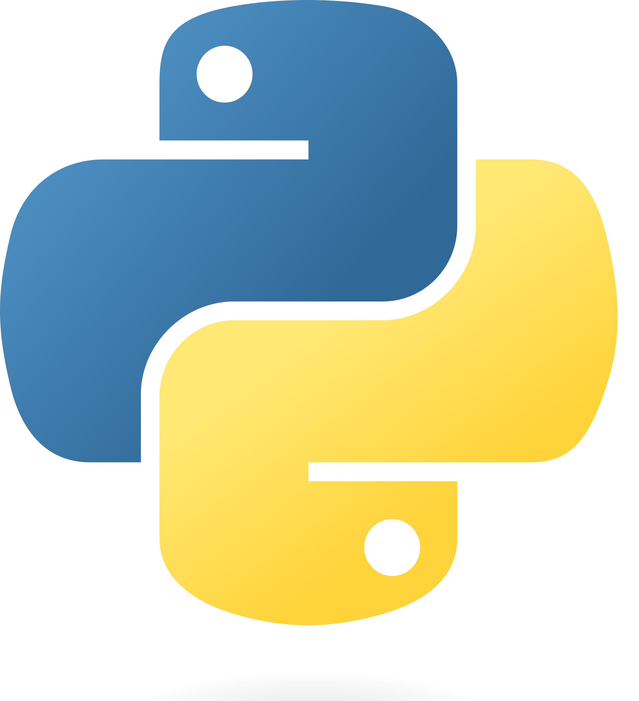
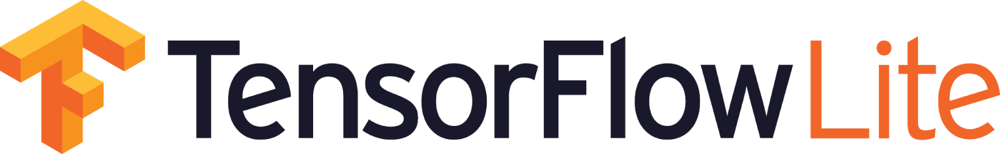
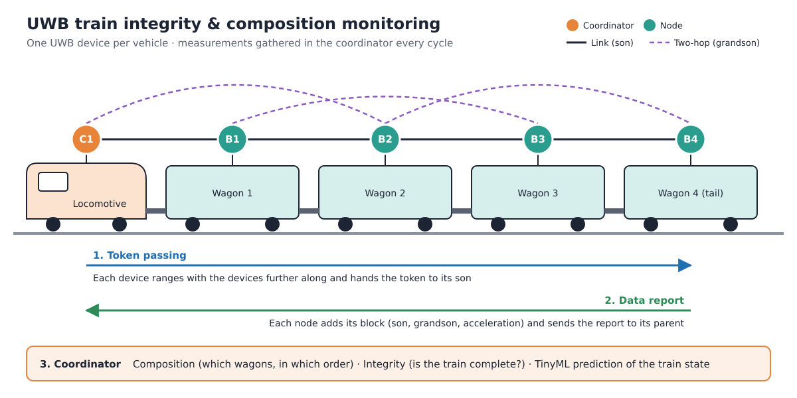
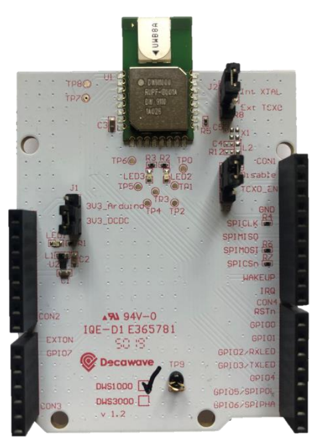

# UWB Train Integrity & Composition Monitoring


      

> A wireless sensor network that uses **UWB (Ultra Wide Band)** ranging to measure and monitor the **integrity and composition of a train**, with on-device intelligence through **TinyML** models.

The network is formed by one UWB device per vehicle. A **coordinator** (on the locomotive) and one **node** per wagon measure the distances between them, gather every measurement in the coordinator in each cycle and, from them, the system knows:

- **Integrity**: whether the train is complete or a coupling has broken.
- **Composition**: which wagons form the train and in which order.

<p align="center">

</p>

The core of the repository is a C++ (Arduino format) library built on top of the DW1000 UWB chip driver, extended with the messaging and network coordination needed for this application.

Base library (MakerFabs): [DW1000 Library](https://github.com/jremington/UWB-Indoor-Localization_Arduino/tree/main/DW1000_library)  
Previous version this one builds on: [Update by @Pizzo00](https://github.com/jremington/UWB-Indoor-Localization_Arduino/tree/main/DW1000_library_pizzo00)

### Index

1. [Goal of the project](#goal-of-the-project)
2. [Key features](#key-features)
3. [UWB distance measurement: TWR](#uwb-distance-measurement-twr)
4. [Background and context](#background-and-context)
5. [Library examples](#library-examples)
6. [Hardware](#hardware)
    - [CookieNodes (CEI-UPM)](#cookienodes-cei-upm)
    - [DW1000 module](#dw1000-uwb-chip)
    - [ESP32 Wroom32](#esp32-wroom32)
    - [STM32 Nucleo F429ZI](#stm32-nucleo-f429zi)
    - [DWS1000](#dws1000)
7. [Programming the boards](#programming-the-boards)
    - [Arduino IDE](#arduino-ide)
    - [PlatformIO](#platformio)
        - [Coding the Nucleo F429ZI: pin definitions](#coding-the-nucleo-f429zi)
8. [Version history](#version-history)
9. [Project status](#project-status)

<br><br>

### Goal of the project

This project studies the use of UWB technology in railway systems, as an onboard alternative to monitor the train without relying on trackside infrastructure.

The goal is that a **coordinator** device knows, in every cycle, all of the distances needed to know the complete train: its length, its composition and its integrity. On top of those measurements, a TinyML model running on the coordinator classifies the state of the train.

The system is designed to run on **CookieNodes**, the modular wireless sensor network platform developed at the Centro de Electrónica Industrial (CEI) of the UPM (see [CookieNodes](#cookienodes-cei-upm)). Other boards with the same UWB chip have been used during development (see [Hardware](#hardware)).

<br>

### Key features

Compared to the base DW1000 library, this version adds:

- **Unicast messaging**: polling, ranging and every control message are addressed to a single device, so the rest of the network ignores them.
- **Network coordination**: the coordinator centralizes the measurements of every device. Three topologies are implemented as examples: hub & spoke, linear token passing (chain) and mesh token passing.
- **Token passing**: the turn to range (the *token*) travels along the train, from the coordinator to the tail. Each node only measures with the devices further along the line, so the measurable length is not limited by the coordinator's reach.
- **Data reports**: each node sends its measurements back to its parent, and they travel up the chain to the coordinator in a single report.
- **Retries, timeouts and inactive devices**: lost messages are retried, and devices that don't answer are marked as inactive until the next cycle.

The development branches extend this with the train composition analysis and the TinyML model (see [Project status](#project-status)).

<br>

### UWB distance measurement: TWR

**Two Way Ranging (TWR)**

To measure the distance between two UWB devices, this library uses the Two Way Ranging protocol, shown in the following image:

<p align="center">

</p>

One of the devices starts the communication (it does the *polling*), while the other one answers.

1. The polling device (from now on, the *initiator*) sends the initial message until another device answers.
2. The answering device (the *responder*) sends back the instant in which the poll was received and the instant in which its answer was sent.
3. Finally, the initiator sends a final message with the instant in which the answer was received and the instant in which this final message was sent.

This way, the responder knows every timestamp needed to calculate the time of flight (ToF) of the messages. Multiplying it by the propagation speed gives the distance between the two devices.

The library can range with more than one device at the same time. To see how these messages are built, check *DW1000Ranging.cpp*.

<br>

### Background and context

When working with ESP32-UWB modules, the communication options between devices offered by the original library were limited: it was designed to locate tags with fixed anchors, not to coordinate a network.

The aim here was to centralize the data of the whole system in one coordinator device. In a train, this means that all of the information is available at one point (for example, the locomotive), from where it could also be sent to a remote control station.

This work started as my Bachelor's thesis (TFG) at the ETSII-UPM and continues as research for my Master's thesis.

<br>

### Library examples

The examples are in the [example](/example) folder. Each one has its own readme:

1. [*1-1 Distance*](/example/1-1%20Distance): measures the distance between two boards (initiator and responder) using TWR.
2. [*2D Positioning*](/example/2D%20Positioning/): a Python app plots the position of 2 anchors and 1 tag in real time.
3. [*Hub & Spoke Coordination*](/example/Hub%20&%20Spoke%20coordination): centralizes the system's data in a coordinator, using a hub & spoke (star) topology.
4. [*Chain Token Passing*](/example/Chain%20token%20passing/): centralizes the measurements in the coordinator using a linear token passing topology, the one that matches a train.
5. [*Mesh Token Passing*](/example/Mesh%20token%20passing): extends the previous example to mesh networks, not only linear layouts.

The [extras](/extras) folder has the auxiliary Python and MATLAB tools used with the examples (plotting, data collection).

<br>

### Hardware

All of the boards used share the same UWB chip, the DW1000. Using several boards has served to check that the code works across platforms and development environments.

<br>

#### CookieNodes (CEI-UPM)

The **Cookies** are a modular hardware platform for wireless sensor networks developed at the Centro de Electrónica Industrial (CEI) of the Universidad Politécnica de Madrid. Each node is built by stacking layers, each one with a single function:

- **Processing**: the microcontroller that runs the application.
- **Communication**: the radio. In this project, the UWB communication is provided by the DW1000 chip.
- **Sensing**: the sensors of the node (for this application, an IMU to measure the acceleration of each wagon).
- **Power supply**.

Thanks to this modularity, a layer can be redesigned (for example, a new sensor) without changing the rest of the node. **The CookieNodes are the target device of this project**: the system is designed so that each vehicle of the train carries one of them. The ESP32 and Nucleo boards below have been used for development and testing.

<br>

#### DW1000 (UWB chip)


This chip is the core of the project: it transmits and receives the UWB messages. The main documents to work with it are:

- [*DW1000 User Manual*](https://www.qorvo.com/products/d/da007967)
- [*DW1000 Datasheet*](https://www.qorvo.com/products/d/da007946)
- [*Transmit Power calibration and management*](https://www.qorvo.com/products/d/da008453)
- [*Antenna delay calibration for the DW1000 & similar products*](https://www.qorvo.com/products/d/da008449)
- [*Channel effects on communication range*](https://www.qorvo.com/products/d/da008440)
- [*Maximizing range in DW1000 based products*](https://www.qorvo.com/products/d/da008450)

To see all of the available documents, visit [Qorvo: DW1000 documentation](https://www.qorvo.com/products/p/DW1000#documents).
<br><br>

#### ESP32 Wroom32


The ESP32-UWB boards by MakerFabs have an ESP32-Wroom32 microcontroller and a DW1000 chip built in. They are the main development boards of the project.
<br><br>

- [ESP32-UWB MakerFabs](https://www.makerfabs.com/esp32-uwb-ultra-wideband.html)
- [ESP32 Wroom Datasheet](https://www.espressif.com/sites/default/files/documentation/esp32-wroom-32_datasheet_en.pdf)

<br><br>

#### STM32 Nucleo F429ZI


STM32 Nucleo-F429ZI boards have also been used. They don't have a DW1000 chip, so they need a shield that has it: the [DWS1000](#dws1000).

[STM32 NUCLEO F429ZI](https://www.st.com/en/evaluation-tools/nucleo-f429zi.html)

<br><br>

#### DWS1000



An Arduino form-factor shield that connects to the Nucleo boards through their Arduino-compatible 'Zio' connectors.

To use it, the code must declare the right pins and initialization. See [Coding the Nucleo F429ZI](#coding-the-nucleo-f429zi).

[DWS1000 Product Details - Qorvo](https://eu.mouser.com/ProductDetail/Qorvo/DWS1000?qs=TiOZkKH1s2Q1L44eotOGgw%3D%3D)  
[DWS1000 Product Brief](https://eu.mouser.com/datasheet/3/1081/1/dws1000productbriefv10.pdf)

<br><br>

### Programming the boards

#### Arduino IDE

> The Arduino IDE has been used to program the ESP32-Wroom32 boards.


The ESP32 boards don't have a built-in debugger, so it wasn't a criterion to choose the IDE. The Arduino IDE was chosen because it allows having several serial monitors open at once, which is key to follow the messages between devices.

##### Setting up the Arduino IDE

1. Install the ESP32 boards: *Tools > Board > Boards Manager*, search for "ESP32" and install the *Espressif Systems* package.
2. Install the libraries the examples need: *Sketch > Include Library > Manage Libraries*, and install:
    - *ArduinoJson* (used by the coordinators).
    - *Adafruit_SSD1306* (only if the board's display is used).
3. Install this library: download the repository as a .zip and add it with *Sketch > Include Library > Add .ZIP Library*.

<br><br>

#### PlatformIO

> The VS Code extension PlatformIO has been used to program the Nucleo F429ZI boards.


These boards have a built-in debugger, and PlatformIO allows using it. PlatformIO also supports the ESP32 boards, so it can program every device. Its main limitation is that it has only one serial monitor: if the application needs only one, it is the best option.

PlatformIO is set up in the *platformio.ini* file of the project, which must declare:

<div align="center">

| Parameters to include in the *ini* file | |
|---|---|
| • Environments | • Library dependencies |
| • Boards | • Monitor speed |
| • Framework | • Upload protocol |

</div>

For example:

```ini
[platformio]
default_envs = nucleo_coordinator

[env]
framework = arduino
monitor_speed = 115200
lib_extra_dirs = C:/Users/ (path to the folder where the library is stored)
lib_deps = (name of the library, as in library.properties)

[nucleo_base]
platform = ststm32
board = nucleo_f429zi
build_flags =
    -D nucleo_f429zi

[env:nucleo_coordinator]
extends = nucleo_base
build_src_filter = -<*> +<Chain Token passing/coordinator.cpp>   ; file compiled in this environment
```

The **key** line is the library dependency: this way, any local change to the library is used when uploading code with PlatformIO.

For more details, check the [PlatformIO ini official guide](https://docs.platformio.org/en/latest/projectconf/index.html).

##### Coding the Nucleo F429ZI

The SPI and pin definitions of the ESP32 boards are not valid for the Nucleo boards. The following code includes both; define one or the other before uploading:

```c++
#define STM_NUCLEO_F429ZI
//#define ESP32_WROOM32

#ifdef ESP32_WROOM32
    #define SPI_SCK 18
    #define SPI_MISO 19
    #define SPI_MOSI 23

    const uint8_t PIN_RST = 27; // reset pin
    const uint8_t PIN_IRQ = 34; // irq pin
    const uint8_t PIN_SS = 4;   // spi select pin
#endif

#ifdef STM_NUCLEO_F429ZI
    #define SPI_SCK D13
    #define SPI_MISO D12
    #define SPI_MOSI D11
    #define DW_CS D10

    #define PIN_RST D7 // reset pin
    #define PIN_IRQ D8 // irq pin
#endif
```

Once the pins are declared, the SPI bus and the DW1000 must be initialized:

```c++
void initHardware();

void setup(){
    (...)
    initHardware();
    (...)
}

void initHardware(){

    #ifdef ESP32_WROOM32
        SPI.begin(SPI_SCK, SPI_MISO, SPI_MOSI);                     // SPI bus start
        DW1000Ranging.initCommunication(PIN_RST, PIN_SS, PIN_IRQ);  // DW1000 start
    #endif

    #ifdef STM_NUCLEO_F429ZI
        SPI.setMOSI(SPI_MOSI);
        SPI.setMISO(SPI_MISO);
        SPI.setSCLK(SPI_SCK);
        SPI.begin();

        DW1000Ranging.initCommunication(PIN_RST, DW_CS, PIN_IRQ);   // Reset, CS, IRQ pins
    #endif
}
```

<br><br>

### Version history

The changes of each release are documented in [releases.md](releases.md) and in the repository's [Releases](https://github.com/jimmyperezp/Libreria-TFG/releases).

<br>

### Project status

🟢 The project is active.

Current work, in the development branches:

- **Train composition**: the coordinator builds the order of the train from the data report of each cycle and detects new, missing or reordered wagons.
- **TinyML**: a model trained in Edge Impulse (with data from a railway simulator and from the real devices) classifies the state of the train on the coordinator.
- **Hardware**: adding an IMU to each device and moving the system to the CookieNodes.

<br><br>

---------
Author: Jaime Pérez Pérez  
Last update: 18/11/2026

